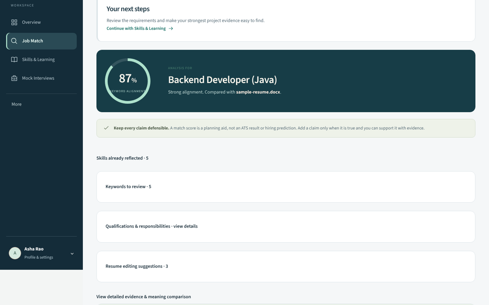
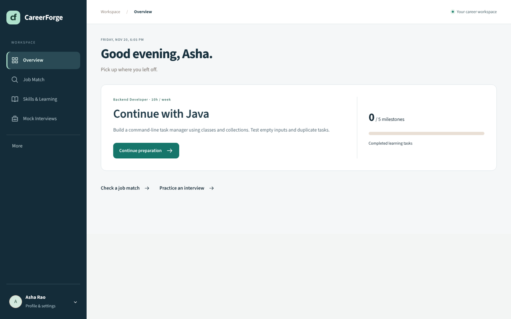
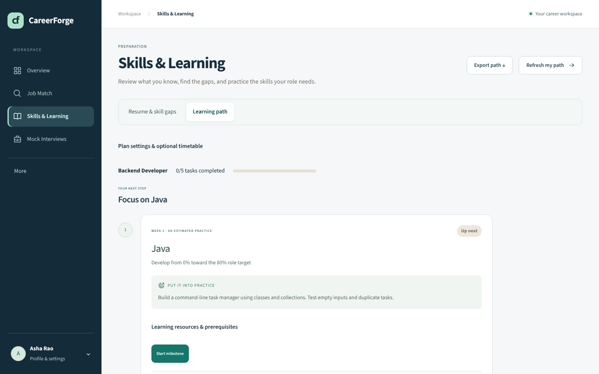
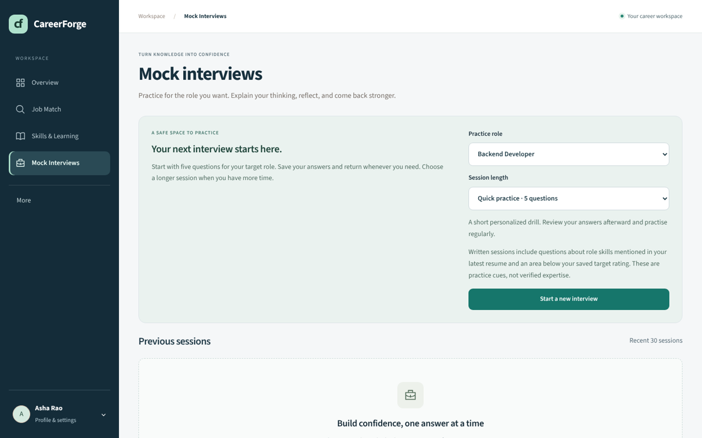
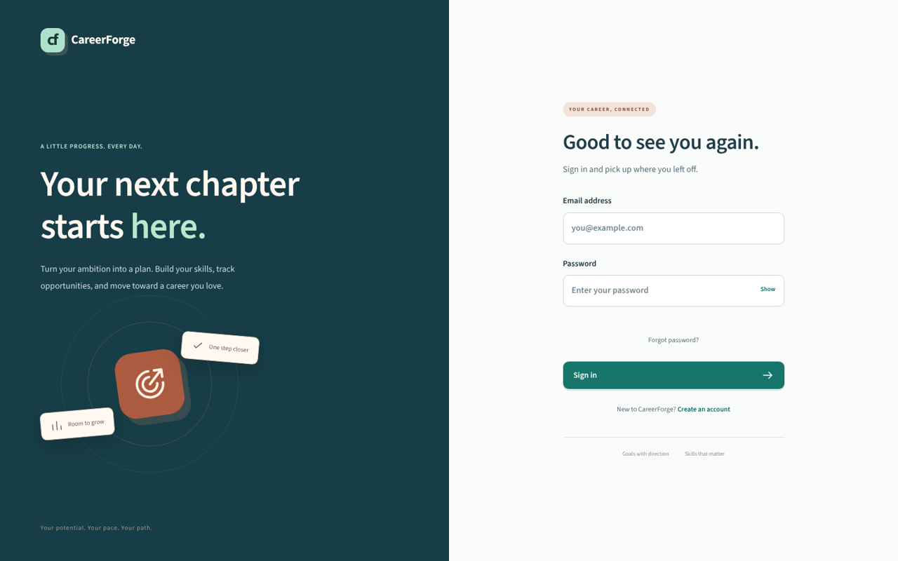

# CareerForge

A full-stack career preparation platform. Upload a resume, see the skills it contains, follow a learning plan for your target role, practise mock interviews and check how well your resume matches a job description.

Built with **Java 21 · Spring Boot 4 · Spring Security (JWT) · Spring Data JPA · MySQL · React 19 · Vite**.



## Features

- **Resume skill extraction** – upload a PDF or DOCX resume; skills are extracted with Apache PDFBox and Apache POI, then reviewed and rated by the user.
- **Role-based learning paths** – nine supported roles (Backend Developer, Java Developer, Data Scientist and more) with milestones, practice tasks, resources and progress tracking.
- **Mock interviews** – role-specific questions with saved answers, resumable sessions and review history.
- **Job match** – compare a job description with your resume and get matched skills, keywords to review and resume suggestions. This is keyword alignment, not an ATS score.
- **Optional AI career coach and AI interview questions** – OpenAI integration with JSON-schema structured output, response validation and a fallback to curated questions when AI is unavailable.
- **Accounts** – registration, sign-in, password recovery (optional email provider) and per-user data isolation.

## Screenshots

| Dashboard | Learning path |
|---|---|
|  |  |

| Mock interviews | Sign in |
|---|---|
|  |  |

_Screenshots use a fictional demo account and sample resume._

## Architecture

```
React 19 + Vite  ──HTTP /api──▶  Spring Boot REST API  ──JPA──▶  MySQL
 (frontend/)                      (backend/)                      (H2 in tests)
                                  ├─ Controller → Service → Repository
                                  ├─ Stateless JWT auth + BCrypt
                                  ├─ Global exception handler
                                  └─ Optional OpenAI client
```

- **Layered backend**: controllers handle HTTP, services hold business logic, Spring Data repositories handle persistence. 14 JPA entities mapped to MySQL.
- **Security**: stateless JWT authentication, BCrypt password hashing, CORS configured for the React frontend, ownership checks so users only see their own data.
- **Error handling**: a global exception handler returns consistent JSON errors.
- **Feature packages**: `journey` (learning plans), `interview`, `jobmatch`, `recovery`, alongside the core `controller` / `service` / `repository` / `model` packages.

Main API groups: `/api/users`, `/api/resumes`, `/api/skills`, `/api/journey`, `/api/interviews`, `/api/job-matches`, `/api/applications`, `/api/career-goals`, `/api/dashboard`, `/api/health`.

## Run locally

**Requirements:** Java 21, Node.js 22+, MySQL 8.

1. Create a MySQL database named `careerforge`.
2. Set the backend environment variables listed in [`backend/.env.example`](backend/.env.example) (database URL, username, password, JWT secret, frontend origin). The app reads them from the process environment; it does not load the file automatically.
3. Start the backend (port 8080):
   ```bash
   cd backend
   ./mvnw spring-boot:run
   ```
   On Windows use `.\mvnw.cmd spring-boot:run`.
4. Start the frontend:
   ```bash
   cd frontend
   npm ci
   npm run dev
   ```
   Open the address Vite prints (http://127.0.0.1:5173).

**Quick preview without MySQL** – runs on a temporary in-memory H2 database (data is lost on restart, AI disabled):

```bash
cd backend
./mvnw spring-boot:run -Dspring-boot.run.useTestClasspath=true -Dspring-boot.run.profiles=test
```

**Optional AI features** – set `OPENAI_API_KEY` and `OPENAI_MODEL` in the backend environment. Never put the key in frontend variables or commit it. Without a key the app uses rule-based guidance and curated questions.

## Tests

```bash
cd backend && ./mvnw test        # 30 JUnit tests on an H2 test profile
cd frontend && npm run lint && npm run build
```

## Project structure

```
backend/   Spring Boot API, tests, database migrations, Dockerfile, deployment notes
frontend/  React app, feature documentation and deployment config
docs/      README screenshots
```

More detail: [frontend guide](frontend/README.md) · [frontend deployment](frontend/DEPLOYMENT.md) · [backend hosting notes](backend/FREE_HOSTING.md) · [deployment readiness](backend/DEPLOYMENT_READINESS.md)

## Status

Portfolio project in active development. Readiness scores and job matches are learning guidance, not hiring predictions. A public hosted demo is not available yet.

## Privacy

Credentials, uploaded resumes, runtime data and build folders are excluded from the repository. Use your own environment variables and never commit real secrets.

## Author

**Shashank CS** – [Portfolio](https://shashank77889.github.io) · [LinkedIn](https://www.linkedin.com/in/shashank--cs) · [GitHub](https://github.com/shashank77889)
